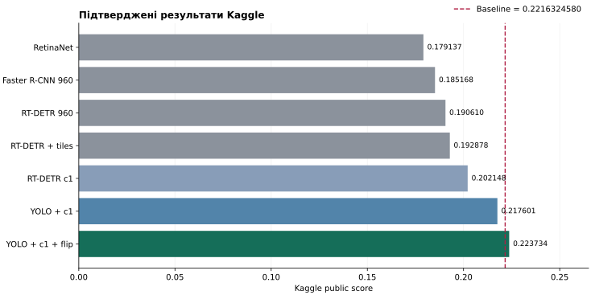
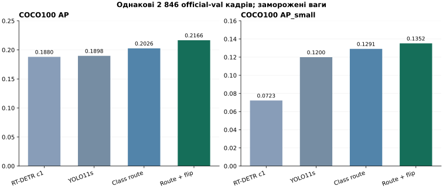

## 1. Завдання та підсумок

Мета — детекція восьми класів на відео з дрона. Змагання: [Multiple Object Video Detection](https://www.kaggle.com/competitions/multiple-object-video-detection-hw-2-ucu-ai-2026). [Код і журнали](https://github.com/yelgor/AI_lab_2/tree/21f49d1ba14c34924a49c54e133e6cac069364ac): commit `21f49d1`.

**Public score — 0.2237335225. Baseline 0.2216324580 перевищено на 0.0021010645**, або 0.2101 процентного пункту. Це результат ансамблю RT-DETR і YOLO11s із горизонтальним віддзеркаленням під час передбачення. Private score не зафіксований.

## 2. Дані та перевірка якості

Набір побудований на VisDrone2019-VID:

| Частина | Відеопослідовності | Кадри | Використання |
| --- | ---: | ---: | --- |
| Train | 56 | 24 201 | Навчання |
| Official validation | 7 | 2 846 | Порівняння та відбір моделей |
| Test | 48 | 3 811 | Передбачення для Kaggle |

Класи: `person`, `bicycle`, `car`, `van`, `truck`, `tricycle`, `bus`, `motor`. Багато об’єктів займають кілька десятків пікселів, тому перевіряли більшу роздільність та плитки кадру. Часову інформацію фінальний метод не використовує.

Підготовка перевіряє відповідність кадрів і розмітки. Для навчання YOLO ігноровані ділянки маскуються; на validation зображення не маскуються, а evaluator враховує ignored regions. Нумерація класів у YOLO та CSV — 0–7, усередині COCO evaluator — 1–8. Після resize/letterbox бокси повертаються в координати оригіналу.

Фінальні порівняння виконані на **всіх 2 846 official-val кадрах**, без додавання їхніх міток до навчання цих кандидатів. Короткі проби на 192 або 512 кадрах використовували лише для попереднього відбору. Для фінального YOLO-рецепта всі 24 201 train-кадри доступні без проріджування (`frame_step=1`); завершення повного курсу з 20 епох не заявляється.

Основний внутрішній показник — COCO AP, усереднений за IoU 0.50–0.95. Окремо рахували AP50, AP_small і варіанти з лімітом 100 та 500 детекцій. **Локальний AP і Kaggle score — різні вимірювання.** Official val багаторазово використовувався для відбору, тому його результат не є новою незалежною оцінкою узагальнення. Початкові fold-розбиття мали ризик спільних сімейств польотів; завершену незалежну CV/OOF за ними не підтверджено.

## 3. Моделі та навчання

Перевіряли чотири потрібні сімейства та додали YOLO11s:

| Сімейство | Модель | Як працює |
| --- | --- | --- |
| Two-stage, anchor-based | Faster R-CNN ResNet50-FPN | RPN пропонує області, другий етап уточнює клас і бокс |
| One-stage, anchor-based | RetinaNet ResNet50-FPN | Одразу оцінює anchors; focal loss зменшує вплив легкого фону |
| One-stage, anchor-free | FCOS; далі YOLO11s | Оцінює об’єкти без набору наперед заданих anchor-боксів |
| Query-based | RT-DETR R50 | Зіставляє запити з об’єктами через bipartite matching |

RT-DETR не потребує звичайного NMS для одного проходу; для об’єднання різних плиток він усе одно потрібен. FCOS пов’язує точки ознак з об’єктами; близькі дрібні цілі ускладнюють таке призначення. RPN у Faster R-CNN відсіює фон перед уточненням, але додає обчислення. RetinaNet прибирає цей етап і компенсує дисбаланс позитивних та негативних прикладів через focal loss.

Початкові CNN/RT-DETR конфігурації: pretrained weights, input 960, AdamW, LR `1e-4`, backbone factor `0.1`, seed `42`. Batch, accumulation і бюджети відрізнялись: public scores **не є benchmark за однакового compute budget**.

Для YOLO11s обрали COCO initialization, input 1280, AdamW, LR `0.001`, cosine schedule, один warmup epoch, batch 2, nominal batch 16, mosaic `0.5`, scale `0.3`, seed `42`. Валідація використовує спільний evaluator, а не лише stock YOLO metrics. Числовий збій наступного YOLO checkpoint виявили та виключили; фінальний ансамбль використовує попередні перевірені ваги.

На RTX 4060 Laptop 8 GiB GPU-завдання виконували послідовно, CPU-метрики — паралельно. Кеші передбачень дозволяли порівнювати ансамблі без повторного RT-DETR інференсу.

## 4. Експерименти та результати

### Результати Kaggle

Оцінки підтверджені журналом і скриншотами Kaggle. Для FCOS public submission не зафіксований.

| Варіант | Public score |
| --- | ---: |
| RetinaNet | 0.1791370309 |
| Faster R-CNN, експорт 960 | 0.1851681872 |
| RT-DETR, повний кадр 960 | 0.1906104677 |
| RT-DETR, кадр + плитки | 0.1928780288 |
| RT-DETR c1 після короткого донавчання | 0.2021478454 |
| YOLO + c1, розподіл за класами | 0.2176009680 |
| **Той самий ансамбль + flip-TTA** | **0.2237335225** |
| Competition baseline | 0.2216324580 |



### Контрольоване порівняння фінального ансамблю

Тут використані однакові 2 846 validation-кадрів і ті самі заморожені ваги. COCO100/500 означає відповідний ліміт детекцій evaluator.

| Pipeline | AP100 | AP50 | AP_small | AP500 |
| --- | ---: | ---: | ---: | ---: |
| RT-DETR c1, кадр + плитки | 0.188016 | 0.383383 | 0.072257 | 0.188566 |
| YOLO11s, повний кадр | 0.189765 | 0.380315 | 0.119960 | 0.190570 |
| Розподіл за класами | 0.202613 | 0.401829 | 0.129118 | 0.203428 |
| **Розподіл + YOLO flip-TTA** | **0.216622** | **0.425163** | **0.135170** | **0.217520** |



Спочатку визначили один маршрут: `truck` і `bus` бере RT-DETR c1, решту шести класів — YOLO. Це не усереднення ваг чи координат боксів. Після об’єднання залишається до 500 найвпевненіших детекцій на кадр. Маршрут додав 0.012848 AP проти YOLO; водночас одна із семи відеосімей погіршилась, тому перший експорт мав статус ручного перегляду.

Наступний A/B змінював лише YOLO-інференс: оригінал плюс horizontal flip. Бокси віддзеркалюються назад у координатах letterbox canvas до відновлення оригінального розміру; дублікати прибирає class-aware NMS з IoU `0.6`. **Приріст — 0.014009 AP** проти попереднього ансамблю. Покращились усі сім validation-сімейств; paired family-bootstrap 90% interval для середнього сімейного приросту — `[0.008621; 0.014662]`. За семи сімейств і повторного відбору це допоміжний показник, а не гарантія private score.

Додатковий flip-only прохід зайняв 199.54 s на val та 134.32 s на test; CPU A/B — 355.10 s. Це вартість доданого проходу, **не швидкість усього ансамблю**. Підсумковий Kaggle приріст від TTA становив 0.0061325545.

### Що не спрацювало

Збільшення input саме по собі не дало сталого покращення: Faster R-CNN на пробі з 192 кадрів мав AP 0.1964 / 0.1978 / 0.1574 при 960 / 1280 / 1536. Ці числа не замінюють повну val. Native-crop донавчання RT-DETR завершилось AP 0.1070 проти початкових 0.1676. Пізніший кандидат `224c8cc6f987` покращив локальну оцінку, але мав повідомлений public score приблизно 0.1919, нижчий за c1.

FP32-продовження YOLO після двох епох теж не замінило champion: той самий route+TTA дав AP 0.209765 проти 0.216622. AP_small зріс до 0.139673, але загальний AP впав. **Менший loss або один кращий зріз метрик виявились недостатніми підставами для заміни моделі.**

Три проблеми: дрібні цілі слабші за загальний AP; `bus` у першого ансамблю мав AP 0.006704; приріст між відеосімействами нерівномірний. Це не замінює три візуально розібрані кадри з помилками — їх у пакеті ще немає.

## 5. Фінальний pipeline та відтворення

Обрано `yolo_c1_pair_epoch_004_fliptta.csv`. Він містить усі 3 811 test IDs, 1 624 942 детекції, класи 0–7, коректний порядок і координати в межах кадру; ліміт — 500/кадр. Ваги пошкодженого epoch-4 не використані: назва CSV не визначає походження checkpoint.

| Артефакт | SHA256 |
| --- | --- |
| RT-DETR c1 | `c1d7fcc83dde045578514e64c85e04b215fca988c804985f1a5a313ebe6daab4` |
| YOLO11s | `42e4c916c45a262d1e29863dc7edb919679528fa673241eef4641a25606285a8` |
| Фінальний CSV | `2dee65d0f257ba61569d48ba94ad95e74e740802b7e430cf10556a1fe2ebdce0` |

Залежності: Python 3.11–3.13, PyTorch 2.6.0, TorchVision 0.21.0, Transformers 4.51.3, Ultralytics 8.3.250, pycocotools 2.0.11. У `SOURCE_CONFIG` потрібно налаштувати `data.root` та `data.prepared`:

```bash
git clone --branch experiment/c1-lrhalf-continuous https://github.com/yelgor/AI_lab_2.git
cd AI_lab_2
git checkout 21f49d1ba14c34924a49c54e133e6cac069364ac
python3 -m venv .venv
.venv/bin/python -m pip install -e '.[yolo]'

# WORK — writable-каталог; SOURCE_CONFIG — конфіг із шляхами даних.
.venv/bin/python scripts/start_yolo_training.py \
  --work "$WORK" --config "$SOURCE_CONFIG" --prepare-only
.venv/bin/python scripts/start_yolo_training.py \
  --work "$WORK" --config "$SOURCE_CONFIG" \
  --name yolo11s_1280 --epochs 20 --hours 10 \
  --batch 2 --imgsz 1280 --workers 2
```

Повторне навчання не гарантує той самий SHA або score. Точний інференс потребує двох ваг вище, конфігурацій та validation receipts; вони збережені локально, до Git не включені. RT-DETR: input 960, tile 960, overlap 0.2, NMS 0.6, edge margin 2; YOLO: 1280, native+flip. [Інструкція ансамблю](https://github.com/yelgor/AI_lab_2/blob/21f49d1ba14c34924a49c54e133e6cac069364ac/docs/baseline_next.md) та [CLI](https://github.com/yelgor/AI_lab_2/blob/21f49d1ba14c34924a49c54e133e6cac069364ac/scripts/class_ensemble.py): команди `cache`, `compare-flip`, `export-flip`. Дані, ваги та receipts передаються окремо; Git недостатньо для точного відтворення.

## 6. Відповідність вимогам і висновки

| Вимога | Що підтверджено / чого бракує |
| --- | --- |
| Підготовка даних | Перетворення розмітки, ignored regions, manifests; графіки EDA та приклади GT до звіту ще не додані |
| Чотири типи детекторів | Запуски Faster R-CNN, RetinaNet, FCOS, RT-DETR зафіксовані; є додатковий YOLO |
| Tuning і зміна loss | Є конфігурації та негативні експерименти; повну виміряну абляцію двох параметрів/loss для кожного потрібного сімейства не підтверджено |
| Однаковий benchmark, speed, failure cases | Повний A/B фінальних pipeline є; спільної таблиці всіх сімейств, same-budget curves і трьох розібраних кадрів бракує |
| CV / OOF | Інструменти розбиття є; завершена незалежна CV/OOF не підтверджена |
| Власний pipeline та baseline | Class route і flip-TTA перевірені локально та Kaggle; public baseline перевищений |
| Повні дані | Повний train використовувався; завершений final fit на train+val не підтверджено |
| Звіт і здача | GitHub Pages; LMS, остаточний вибір двох submission і private score потребують окремого підтвердження |
| Бонуси | Temporal methods, W&B і пояснювальні візуалізації не заявляються виконаними |

Комбінація моделей і контрольований inference-експеримент перевищили baseline без тривалого донавчання. Решта вимог потребує підтвердження артефактами.

## Джерела

- [Умова лабораторної](https://github.com/yelgor/AI_lab_2/blob/21f49d1ba14c34924a49c54e133e6cac069364ac/docs/assignment/kaggle-original.txt), [журнал public scores](https://github.com/yelgor/AI_lab_2/blob/21f49d1ba14c34924a49c54e133e6cac069364ac/experiments/leaderboard_results.json).
- [VisDrone](https://arxiv.org/abs/2001.06303), [COCO metrics](https://cocodataset.org/#detection-eval), [TorchVision detectors](https://pytorch.org/vision/0.21/models.html#object-detection).
- [Faster R-CNN](https://arxiv.org/abs/1506.01497), [RetinaNet](https://arxiv.org/abs/1708.02002), [FCOS](https://arxiv.org/abs/1904.01355), [RT-DETR](https://arxiv.org/abs/2304.08069), [Ultralytics YOLO11](https://docs.ultralytics.com/models/yolo11/), [SAHI: sliced inference](https://arxiv.org/abs/2202.06934).
